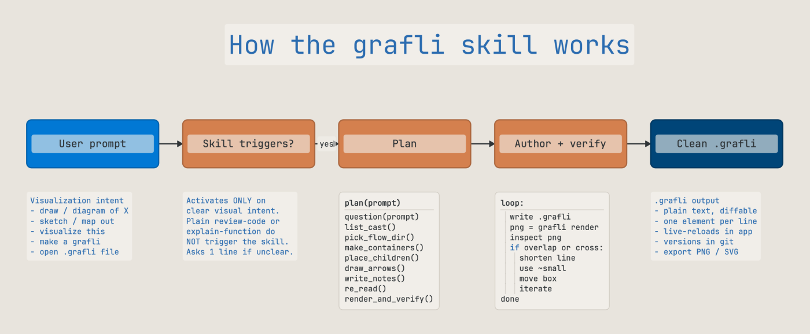

# Pair grafli with your AI

grafli isn't just a diagram editor — it's the canvas your coding agent
uses to **communicate complex systems back to you**. A `.grafli` file
is plain text, line-oriented, and small enough that an LLM can read,
modify, and produce it in seconds. The bundled grafli **skill**
teaches the agent how to do that *well*.



The diagram above is itself a `.grafli` (`examples/skill-explained.grafli`)
authored under the same skill it describes — meta-correct, and a small
demonstration that the workflow holds.

## Why a skill is needed

Without guidance, a generic LLM will invent broken `.grafli` syntax,
fight the renderer's layout model, and produce diagrams that look
plausible in the conversation but render as overlapping boxes and
crossed arrows in the actual app.

The skill gives the agent:

- **A planning loop** — "what question does the diagram answer?"
  before any boxes get placed, so the diagram has a point.
- **Layout discipline** — grid alignment, container margin model,
  flow direction, fan-out handling, the typography scale, and the
  zoomed-out (semantic-zoom) reading as a second thing to author.
- **Collaboration etiquette** — working `T:`/`Q:` notes on a shared
  board, minimal diffs, proposals instead of unilateral restructuring.
- **Code-mode authoring style** — predicate-style names, contract
  keywords for review focus, when to use a code-block versus split
  the logic into multiple nodes.
- **Presentation authoring** — flows, scoped stops, text slides,
  container-as-slide composition, PDF/PPTX export incl. templates.
- **Thinking-board patterns** — decision boards, tension maps,
  question landscapes, and the deliberate-incompleteness rules that
  keep the board a tool for *your* thinking.
- **Explanation maps** — maps of any subject you read level by level:
  each level states its question and the evidence for its split, box
  docs and sub-boards hold the depth, tours walk through what happens
  in order, overlay files carry analysis data with its provenance, and
  a `Q:` you leave on the map is answered on the map — with a deeper
  level, one line or a tour.
- **Common-mistakes checklist** — quote escaping, disconnected nodes,
  truncated labels, deprecated keywords. The things that recur.

It's structured as a lean, always-loaded core (`SKILL.md` — triggers,
workflow, etiquette, checklist) plus `references/` files the agent
reads on demand (full format tables, design principles, presenting,
thinking boards, explanation maps) — deep coverage without a heavyweight prompt.

## Install

The skill ships **inside the Python package** as a directory —
`SKILL.md`, its `references/` files and an `examples/` folder holding the
example boards the references point to. The built-in installer places
it where your AI tool expects skills:

```bash
# Install for one or all supported tools (copies SKILL.md, references/, examples/)
grafli skill install claude
grafli skill install all

# Report install status per tool (and whether a newer version shipped)
grafli skill check

# Single-file consumers: stdout is the FULL skill, references inlined
grafli skill -o GRAFLI-SKILL.md
grafli skill --core          # just the lean core, no references

# Print the path of the bundled skill directory (so you can symlink it)
grafli skill --where
```

| AI tool | Where the skill goes | Docs |
|---------|---------------------|------|
| Claude Code | `~/.claude/skills/grafli/` (or per-project under `.claude/skills/...`) | <https://code.claude.com/docs/en/skills> |
| Codex | `~/.agents/skills/grafli/` | <https://developers.openai.com/codex/skills> |
| OpenCode | `~/.config/opencode/skills/grafli/` (also reads the claude/codex paths) | <https://opencode.ai/docs/skills> |

`grafli skill check` compares the installed version against the
packaged one, so re-running `grafli skill install` after
`pip install --upgrade grafli` keeps agents on the latest skill. A
symlink to `grafli skill --where` works too if your platform supports
it comfortably.

## On a live board: what the agent gets

A Claude Code session connected to `grafli serve` through `grafli agent`
(see [Connect your agent](navigating.md#connect-your-agent-a-claude-code-session-you-run))
gets the skill from the bridge itself, so nothing needs to be installed in
that session:

- **The `authoring_guide` tool** returns the skill as it ships with your
  grafli: without arguments the core `SKILL.md`, headed by a few lines that
  map its file steps to the board's tools (`read_board` for reading the
  file, `write_board` for `Write` / `Edit`, `render_board` for
  `grafli render`) and name the reference files; with
  `reference: "format.md"` (or `design.md`, `presenting.md`, …) that one
  reference file. It answers before the session connects too.
- **A pointer to it, twice.** The instructions the bridge gives Claude
  Code when the session starts, and the reply to `/mcp__grafli__connect`,
  both tell the session to read the guide before its first `write_board`
  — unless the grafli skill is already loaded in that session, as it is
  after `grafli skill install claude`.

The guide is always the version of the skill that ships with the running
grafli, so it matches the format the board is read in.

## In the desktop app: hand single changes to your agent

You can build a board with the app's own keys and hand single changes to a
Claude Code session, the way a present link's tab of `grafli serve` does —
on your own, or while an audience follows the board in a browser tab. The
app hosts what `grafli serve` hosts, so you do not start `grafli serve`
yourself. It needs the same extra: `pip install 'grafli[serve]'`; without
it, the app says what is missing and the `:` line still applies grafli
lines.

**Connect a session.**

1. Once, register grafli's MCP server with Claude Code:
   `claude mcp add -s user grafli -- grafli agent`.
2. Start the session so requests from the board reach it:
   `claude --dangerously-load-development-channels server:grafli`
   (see [Connect your agent](navigating.md#connect-your-agent-a-claude-code-session-you-run)
   for what the flag does and when `MCP_PROTOCOL_NEGOTIATION=legacy` helps).
3. In the app, with a saved board open, press <kbd>:</kbd>. The app now
   hosts the board's folder on 127.0.0.1 (port 7341, or a free one when
   that is taken) and writes the state file `grafli agent` looks for. The
   agent's menu in the status bar (**✦ no agent connected**) has **Host
   this board** for the same.
4. In the session, type `/mcp__grafli__connect`. The status bar shows the
   agent by name in purple — **✦ Claude** — and **✦ Claude · gone** when
   its session drops.

With no session connected, the status bar says **✦ no agent connected**,
the `:` line says "plain language: no agent connected", and a request is
answered with "No agent is connected, so nothing was sent". Nothing waits:
a session that connects later hears only what you ask from then on.

**Ask.**

- <kbd>:</kbd> opens the command line along the bottom of the canvas. A
  grafli line — one that starts with `@`, or reads like one without it, such
  as `box cache "Cache"` — is applied to the board at once: a box without a
  place goes below the selection, else in the middle of the view, and
  <kbd>u</kbd> undoes it. Anything else is plain language for the agent:
  "add a cache between api and db". The right end of the line says where
  your text goes; <kbd>↑</kbd> and <kbd>↓</kbd> bring back what you sent
  before.
- <kbd>Shift</kbd>+<kbd>A</kbd> asks about the selected element: the line
  opens as "✦ ask Claude about 'Payments':", and the session hears which
  element the request is about.

**What you see.** While the agent works on a request, a line at the top of
the canvas says "✦ Claude is working on: add a cache between api and db",
with "reading the board" or "rendering the board" as the session does it.
When its edit lands, the app shows it at once: what it added or changed
glows in purple for a few seconds, tagged "✦ Claude · Shift+U undo", and a
toast says what it did ("Claude: +1 box").

| Key | Does |
|-----|------|
| <kbd>Shift</kbd>+<kbd>U</kbd> | Undo the agent's last edit; your own edits since stay |
| <kbd>Enter</kbd> | Take the agent's proposal, while one waits |
| <kbd>x</kbd> | Drop the proposal; the board stays as it was |

A change of more than 5 elements waits as the agent's **proposal**: a
purple banner — "✦ Claude proposes 7 changes · split Payments" — and
dashed outlines where it would add or change something, with what it
removes struck through. The view moves to it when it is out of sight. While
it waits, <kbd>Enter</kbd> and <kbd>x</kbd> act on it rather than on the
selection.

**Guests.** The agent's menu in the status bar copies the board's **edit**
and **watch** links. A guest who opens one in a browser tab sees the same
board, your edits as the app saves them, the agent's edits glowing and the
working line; the app is the presenter they follow. Hosting listens on this
machine only unless you start the app with `grafli --host <your LAN or VPN
address> board.grafli`, as with `grafli serve --host`. **Stop hosting** in
the same menu disconnects the agent and the guests; quitting the app does
too.

**In the standard control scheme** the same commands are on the **Agent**
menu, and none is a single letter:

| Vim keys | Standard controls |
|----------|-------------------|
| <kbd>:</kbd> | <kbd>Ctrl</kbd>+<kbd>L</kbd> or **Agent ▸ Agent line…** |
| <kbd>Shift</kbd>+<kbd>A</kbd> | <kbd>Ctrl</kbd>+<kbd>Shift</kbd>+<kbd>L</kbd>, **Agent ▸ Ask about the selection…**, or **Ask the agent about this…** in the right-click menu |
| <kbd>Enter</kbd> / <kbd>x</kbd> on a proposal | **Agent ▸ Take the proposal** / **Drop the proposal**, also first in the right-click menu while it waits |
| <kbd>Shift</kbd>+<kbd>U</kbd> | **Agent ▸ Undo the agent's edit** |
| <kbd>u</kbd> after a grafli line | <kbd>Ctrl</kbd>+<kbd>Z</kbd> |

The hints on the canvas name the controls of the scheme you are on: the
proposal's banner says "right-click: take · drop", the glowing edit's tag
"Agent ▸ Undo". On a Mac, <kbd>Ctrl</kbd> is <kbd>⌘</kbd>.

The app's agent keys are in its <kbd>F1</kbd> help under **Your agent**,
for the scheme you are on.

## What the skill triggers on

The skill is deliberately **scoped narrowly** to avoid polluting
unrelated conversations. It activates on **explicit visualization
requests** — phrases like:

- "draw a diagram of …"
- "visualize the …"
- "sketch / map out / graph this"
- "make a grafli for …"
- working on existing `.grafli` files

It also activates when you ask the agent to **explain, walk through, or
present** an existing graph — it authors a [flow](bookmarks-flows.md): an
ordered sequence of saved viewpoints with narration, so a big diagram is
taught as a guided tour (playable in-app, presentable fullscreen, exportable
to PDF / PPTX slides) instead of dumped all at once.

And it activates on **thinking-board requests** — "help me think
through X", "weigh the options", "map out the unknowns" — the moments a
human explainer would walk to a whiteboard. The agent then authors a
board that structures the problem (a decision board, a tension map, a
question landscape) rather than one that documents a system.

It activates when you want to **understand, learn, explain or review a
subject on a map** — "map this codebase so I can understand it", "help
me learn X level by level". The agent builds an explanation map: an
overview whose parts you enter with <kbd>g</kbd><kbd>d</kbd>, tours
across its levels, and answers to the `Q:` notes you leave on it.

It does **not** activate on generic "review this code", "explain this
function", or "summarize this module" requests unless the user also
asks for a visual, a board, or a diagram. Keeping the trigger tight
keeps your agent fast and focused on the task at hand.

## A typical session

Once the skill is installed, the agent:

1. Listens for a visualization request.
2. Asks any clarifying question (the planning loop).
3. Produces a `.grafli` file using `Write`.
4. Verifies its own work headlessly: `grafli render` (with `--focus`,
   `--lod`, and `--bookmark` for targeted looks), `grafli fmt` to
   normalize what it wrote into the same canonical form the app saves
   (integer coordinates, canonical spacing — keeps diffs clean),
   `grafli diagnose`
   (incl. `parse-error` findings for lines that would silently drop,
   and `unrelated-children` / `unrelated-board` warnings for boxes that
   relate to nothing),
   `grafli inspect` for placement geometry, `grafli layout` to run the
   app's layered layout over a board's boxes (boxes marked `!pin` stay
   where they are), and `grafli export --check`
   when a deck is involved. `grafli diagnose --fix` applies the
   mechanical corrections (clamping, sizing, mistyped tokens) and exits
   non-zero while errors remain, so the loop can run unattended — what
   needs a judgment call is left for the agent to decide.
5. Iterates on the layout / labels based on feedback.

The agent's output is just text. You can edit it, diff it, version it,
and re-render any time. There is no proprietary format or cloud
service in the loop.

## Render-on-demand for your CI

Because `grafli render` is a non-interactive subcommand, your CI can
re-render diagrams on every push:

```bash
grafli render docs/architecture.grafli docs/architecture.svg
```

Pair this with a markdown reference to the SVG and the diagram in
your design doc stays in sync with the source — the same workflow as
docs-as-code, but for system pictures.

## Combining the skill with code-mode notes

The skill encourages **graph + code-mode** as the default pattern for
review-oriented diagrams: the graph carries *who calls whom*, while
each box has a 5–9 line code-mode note describing *what one function
does*. Together they answer questions neither could answer alone:

- Where could an open redirect hide? (graph locates the box, code
  note shows the `risk` line.)
- What contracts are covered by tests? (`verify:` arrows from a tests
  box mirror the `verify:` lines inside each code-mode note.)
- What's the failure mode of this saga? (each `pre` / `post` / `risk`
  contract is visible at a glance.)

This pattern is the headline differentiator versus generic diagram
tools — and the skill is what gets your agent to produce it cleanly
from a one-line prompt.
