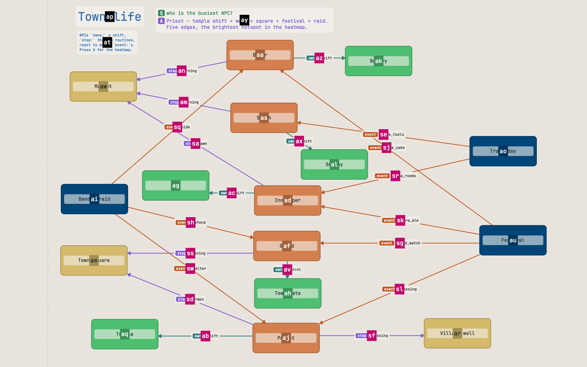

# Navigating graphs efficiently

Once a diagram outgrows a single screen, the bottleneck stops being *drawing*
and becomes *moving around*: find the thing, zoom in, edit it, zoom back out,
find the next thing. grafli is built so that whole loop stays on the keyboard
and takes a handful of keystrokes — no pan-drag-scroll-wheel dance.

This page is the tour of what's possible. For the exhaustive table see
[Keybindings](keybindings.md).

## The overview → focus → overview loop

The single most common rhythm is: sit in an overview, dive into one element,
edit it, pop back out. That's one verb in grafli:

- Select an element (jump to it, search for it, or click it).
- <kbd>g</kbd><kbd>z</kbd> — **focus**: the selection zooms up to fill the
  viewport, and grafli remembers where you came from.
- <kbd>e</kbd> — edit it inline.
- <kbd>g</kbd><kbd>z</kbd> again — **fly back** to the exact overview you left.

!!! tip "Hop between elements without losing your way out"
    While focused, change the selection and press <kbd>g</kbd><kbd>z</kbd>
    again — it re-focuses on the new element but *keeps* your original return
    view. A final <kbd>g</kbd><kbd>z</kbd> always lands you back where the loop
    started.

Everything below is a faster way to do the "select an element" and "find your
way around" parts of that loop.

## Find and select an element

- **Jump labels** — <kbd>f</kbd> (or <kbd>Ctrl</kbd>+<kbd>J</kbd>) tags every
  visible item with a one- or two-character label; type it to select that item.
  This is the fastest way to put the cursor on something you can see.
- **Search** — <kbd>/</kbd> fuzzy-matches by label and dims everything else.
  <kbd>Tab</kbd> / <kbd>Shift</kbd>+<kbd>Tab</kbd> cycle the matches;
  <kbd>Esc</kbd> clears the filter.



## Move through the hierarchy

When boxes are nested, walk the tree directly instead of hunting visually:

- <kbd>g</kbd><kbd>p</kbd> — select the **parent** (and zoom to it if it isn't
  fully on screen).
- <kbd>g</kbd><kbd>c</kbd> — select the **first child**.
- <kbd>Tab</kbd> / <kbd>Shift</kbd>+<kbd>Tab</kbd> — cycle **siblings**.

The status bar shows a breadcrumb of where you are, so you always know your
depth.

## Go into a board and back out

A box whose `&graph` sub-board or `.grafli` `&link` you open with
<kbd>Return</kbd> or <kbd>g</kbd><kbd>d</kbd> takes you one board down: the
view zooms into the box and hands over to the board it opens.
<kbd>g</kbd><kbd>u</kbd> zooms back out to the board you came from, exactly as
you left it — same zoom, scroll and selection, no re-fit. While you are inside, the breadcrumb starts with the
boards you came through, for example `System › Combat › impact()`. On a board
you did not enter that way, <kbd>g</kbd><kbd>u</kbd> says "Already at the top".
<kbd>Ctrl</kbd>+<kbd>O</kbd> / <kbd>Ctrl</kbd>+<kbd>I</kbd> walk the view
history of the board you are on only.

A link can point at one place in the board it opens: `&graph:combat#impact`
or `&link:../System.grafli#impact` opens the board framed on the bookmark
`impact` — or, if there is no such bookmark, on the element `impact` — with it
selected. If the board has neither, it opens fitted and says
"No element 'impact' in combat.grafli". `grafli diagnose` reports such a link,
and a link to a board that does not exist, as an error
(`dangling-board-link`).

Once a box with a `&graph` sub-board is large enough on screen, it shows a
miniature of that board filling the box, so you can see what is inside before
you go in. The label and the sub-board icon sit on a band across the top of
the box, in the box's own fill, so they stay readable over the miniature. The miniature follows the sub-board file: change the file and the
miniature updates. Zooming in on it never switches boards on its own — only
<kbd>Return</kbd> or <kbd>g</kbd><kbd>d</kbd> does. Exports show the box
without the miniature.

A box with a `&doc` shows the first sentence of its doc on one line below its
label, once you are close enough to read it and when the box is wide enough for
the whole sentence; a sentence that would be cut is left out. To read the whole
doc without leaving the board, select the box and press
<kbd>g</kbd><kbd>v</kbd>: a read-only panel opens beside the box, scrollable
when the doc is long, and
<kbd>Esc</kbd> closes it. <kbd>E</kbd> opens the doc for editing. When the doc
file changes, the line and an open panel follow. Renders and exports show the
line too; a PDF or PPTX slide shows it only where the slide's frame keeps it
large enough to read, as the canvas does at its zoom.

To *build* that hierarchy, select one or more elements and press
<kbd>Ctrl</kbd>+<kbd>G</kbd> — grafli wraps them in a new parent box sized to
contain them, then opens its label editor so you can name the group. Inner
nesting is preserved, and if everything you selected already shared a parent,
the new box slots in beside them under it. Drag an element onto a box to nest it
the other way around.

## Follow the wiring

To trace how things connect rather than where they sit:

- **Graph navigation** — hold <kbd>Alt</kbd> and grafli overlays a key on each
  connector leaving the current node; press it to hop along that edge, chord by
  chord.
- **Subgraph focus** — <kbd>B</kbd> isolates the selected node and its
  neighbourhood (press again to cycle direction); <kbd>Shift</kbd>+<kbd>B</kbd>
  toggles between the full subgraph and just one hop. Great for "show me only
  what touches this".

## Zoom and frame

- <kbd>+</kbd> / <kbd>-</kbd> — zoom in / out, anchored on your selection.
- <kbd>z</kbd> — step through fixed zoom levels (25 → 50 → 100 → 150 %, wraps).
- <kbd>Shift</kbd>+<kbd>Z</kbd> — zoom to fit the **whole graph** (your reset to
  overview).
- <kbd>g</kbd><kbd>z</kbd> — focus the selection / fly back (see above).

## Retrace your steps

grafli keeps a vim-style jumplist of viewports:

- <kbd>Ctrl</kbd>+<kbd>O</kbd> — jump **back** to the previous viewport.
- <kbd>Ctrl</kbd>+<kbd>I</kbd> — jump **forward** again.

Any navigation jump (a jump-label, <kbd>g</kbd><kbd>p</kbd>, a zoom step) pushes
onto this list, so you can always undo your way back through where you've
looked.

## Keep the big picture in view

- <kbd>M</kbd> — toggle the **minimap**: a corner overview with your viewport
  rectangle, so you never lose your bearings in a large graph.
- <kbd>A</kbd> — **connectivity heatmap**: colours boxes by how many graph
  arrows touch them (arrows to and from notes or images don't count), to
  spot where the density is. When the board has
  [overlay files](format.md#overlay-files) beside it, further presses show
  each of them in turn — test results, churn, whatever a script wrote — with
  a legend card that shows the selected element's note and refs. The overlay
  on screen goes into the SVG/PNG and PDF/PPTX exports with its legend.

## Read a board zoomed out (semantic zoom)

Zooming a large board all the way out used to shrink everything into
unreadable specks. Instead, grafli **simplifies as you zoom out** — the
further you pull back, the more the canvas summarises itself, like a map that
drops street names before town names before city names. It's on by default and
needs no setup: just zoom out (<kbd>-</kbd>, <kbd>z</kbd>, or
<kbd>Shift</kbd>+<kbd>Z</kbd> to fit the whole graph).

What happens as you pull back:

- **Containers fold into tiles.** A group whose children have shrunk too small
  to read collapses to a single tile showing its label; its contents hide and
  arrows re-route to the tile. The label's size follows the group's nesting
  level, not its area: tiles at the same level show their titles at the same
  size, top-level groups the largest. Nested groups fold innermost-first, and
  smaller groups fold before larger ones.
- **Leaves become shells.** A standalone box whose label is too small keeps its
  colour and shows skeleton bars where the text was — you still see *that
  there's a node here*, without the unreadable label.
- **Loose clusters get a hull.** A connected, compact group of three or more
  free-floating nodes wraps in a labelled "bubble" outline (named by its
  busiest node), with outside arrows attaching to the boundary.
- **Notes and images** follow suit: a note that gets too small shows a marker
  so it never silently vanishes, and anything inside a folded container is
  subsumed into its tile.

At **100 %** the board is always shown in full — aggregation is purely a
zoom-*out* affordance — and a hysteresis band keeps the tiers from flickering
as you scrub the zoom. The summary tracks your edits **live**: add, connect, or
delete nodes and the zoomed-out view reflects it right away.

!!! tip "Dive into a summarised group"
    Aggregated tiles and hulls are read-only — you edit at full detail.
    **Double-click** a tile or hull to fly straight into that group, or just
    zoom back in. To switch the whole behaviour off (back to plain uniform
    shrinking), press <kbd>Shift</kbd>+<kbd>D</kbd>.

While summarising, the status bar shows a `◧ LoD` indicator, and the minimap
(above) outlines the regions that are currently folded — so you can see at a
glance how much of the board has collapsed.

## Across files

A node can link to a deeper diagram in its own `.grafli` file (a *sub-grafli*).
Click through to descend into it, edit, and come back — so a large system can
be a shallow top-level map plus focused drill-downs instead of one giant
canvas.

## Share the map as one page

`grafli export-html board.grafli board.html` (or **HTML** in the side panel's
Export section) writes the board and every board reachable from it through
`&graph`, `.grafli` `&link` and tour stops in other boards into one HTML
file. It needs no server and no
internet: drawings, script, styles, fonts and images are all inside, so it
opens from a mail attachment or a shared folder in any current browser. It
prints its size and warns above 20 MB.

Each board is drawn by grafli's own SVG export, so the page looks like the
app. On the page:

| Do | What happens |
|----|--------------|
| Drag, wheel, <kbd>+</kbd> / <kbd>-</kbd>, arrow keys | Pan and zoom; <kbd>Shift</kbd>+<kbd>Z</kbd> fits the board |
| Click a box with a level, or select it and <kbd>Return</kbd> / <kbd>g</kbd><kbd>d</kbd> | Zoom into its board |
| **↑ Back**, <kbd>Backspace</kbd> or <kbd>g</kbd><kbd>u</kbd> | Back up, to where you were; the breadcrumb jumps several levels |
| Click a box with a doc, or <kbd>g</kbd><kbd>v</kbd> | Read the doc in a panel beside it; <kbd>Esc</kbd> closes it |
| **Overlay** selector or <kbd>A</kbd> | Switch between no overlay and each overlay file, with its legend and the selected element's note |
| <kbd>Return</kbd> on a box with a web link | Open the link in a new tab |
| **Tour** selector | Play one of the board's tours in the player card |

The tour player shows the stop's caption, a progress bar and **‹ Prev**,
**▶ Play** / **❚❚ Pause**, **Next ›** and **✕**. The camera glides between
stops on one board; a stop in another board shows that board, with the
breadcrumb, and **↑ Back** leads back out. Auto-play rests on each stop for
its dwell (4 s when the stop sets none) and stops at the last one. A stop
dims the rest as the app does: a stop with `focus=complete` everything its
frame does not hold whole, a stop framing an arrow everything but that arrow
and its two ends. While a
tour plays, the keys are the app's playback keys:

| Key | What happens |
|-----|--------------|
| <kbd>Space</kbd>, <kbd>→</kbd>, <kbd>l</kbd>, <kbd>j</kbd> | Next stop |
| <kbd>←</kbd>, <kbd>h</kbd>, <kbd>k</kbd> | Previous stop |
| <kbd>p</kbd> | Cycle paused / playing / loop |
| <kbd>t</kbd> | Smooth or instant camera |
| <kbd>Return</kbd> or <kbd>g</kbd><kbd>d</kbd> on a box with a level | Leave the tour into the level; going back up resumes it |
| <kbd>Backspace</kbd> or <kbd>g</kbd><kbd>u</kbd> | End the tour and go back up |
| <kbd>Esc</kbd>, <kbd>q</kbd> | End the tour, back on its own board |

The page is for reading: code refs (`@path:line`) show as plain text,
because the people you send it to don't have the checkout, and there are no
miniatures and no editing. A link to a board that does not exist is reported
when exporting and left out. `--theme dark` exports the dark theme.

## Show a board live in a browser tab

`grafli serve <dir>` serves the boards in a directory to browser tabs on your
network or VPN. Every change to a board's file — saved by the desktop app,
written by an editor or an agent — is drawn again with grafli's own view and
pushed to every tab on that board; the camera, the selection and an open doc
stay where they were. It is the HTML export page above, kept up to date.

```bash
pip install 'grafli[serve]'
grafli serve boards/ --host 192.168.1.20
```

It prints three links per board in the directory, of the form
`http://<host>:<port>/b/<board>#k=<key>`: a **watch** link and an **edit**
link for the people in the meeting, and a **present** link for you, each
with its own key after the `#`. The page asks for nothing; the key
travels from the link to the server over the WebSocket, and the drawing comes
only after it. A board in a vault (`<board>-res/`) has a link too
(`/b/<board>-res/<name>`), and clicking a level in the tab opens it with the
same key.

- `--host` takes the address of the interface to listen on: your LAN address,
  or your VPN address (`tailscale ip -4`). Without it grafli listens on
  127.0.0.1, this machine only. It never listens on every interface unless
  you give `0.0.0.0`, and then it says so.
- `--port` (default 7341; `0` picks a free one), `--theme dark`, and `-v`
  prints a line per pushed change with how long after the file change it
  went out.
- `grafli serve board.grafli` serves the board's directory and prints only
  that board's links.
- `--reveal` starts every board with only its title showing; see
  [Reveal a prepared board](#reveal-a-prepared-board-as-you-talk).
- A Claude Code session you already run can be the boards' agent; see
  [Connect your agent](#connect-your-agent-a-claude-code-session-you-run).

An edit link's tab can change the board: each edit is a small operation
(move, rename, add a box, connect, delete, a `Q:` question, grafli lines)
applied to the
version the tab shows and merged into the file with the same three-way merge
the desktop app runs when the file changes under it, so an edit never
overwrites a change the tab had not seen yet. A watch link's tab cannot edit.
The present link's tab edits like an edit link's, and the others follow it
(see below).

The files never leave your machine, only drawings of them do, and only to the
tabs that hold a key. The session ends when `grafli serve` stops; there is no
copy anywhere else.

### Building a board in the tab

When you present by sharing only the browser tab, you build the board there
with a few of the app's keys:

| Key | Does |
|-----|------|
| <kbd>f</kbd> | A jump label on every element in view; type one to select that element (a watch link's tab has this key too) |
| <kbd>o</kbd> / <kbd>O</kbd> | A new box below / above the selection, its size, in its container, with an arrow from it; type the label, <kbd>Enter</kbd>. With nothing selected, the box goes in the middle of the view |
| <kbd>Ctrl</kbd>+arrow | The same, on that side (macOS may keep Ctrl+arrows for switching desktops) |
| <kbd>c</kbd> | Connect the selection to the box whose jump label you type; with nothing selected, the first label is where the arrow starts |
| <kbd>e</kbd> | Rename the selected box, note or arrow; <kbd>Enter</kbd> keeps it, <kbd>Esc</kbd> drops it |
| <kbd>x</kbd> / <kbd>Delete</kbd> | Delete the selection, with its arrows |
| <kbd>u</kbd> / <kbd>⌘</kbd>+<kbd>Z</kbd> | Undo your last edit in this tab |
| <kbd>:</kbd> | A command line. A grafli line — `@ box cache "Cache"`, `@ arrow api -> cache "reads"` — is applied: a box line without a place goes below the selection; a line with the id of an element on the board restates that element. Anything else is plain language for the agent (see [Ask the agent](#ask-the-agent-plain-language-and-the-ask-chip)). The right end of the line says where what you typed goes. <kbd>↑</kbd> brings back the last line |
| <kbd>a</kbd> | Ask the agent about the selection (see [Ask the agent](#ask-the-agent-plain-language-and-the-ask-chip)) |
| <kbd>Shift</kbd>+<kbd>Z</kbd> | Fit the board in view (never closer than 1:1), so every box has a jump label |

A new box lands on the side you asked for; if a box already sits there, it
moves further along until it covers nothing. Each edit shows a dashed
placeholder at once — the new box with its label, the new label over the
old one, a dashed line for a new arrow, a faded element for a delete — and
the badge counts the edits on the way, until the drawing that holds them
arrives.

Undo takes back only your own edits, one at a time, and keeps what others
changed since: undoing a box you added also drops an arrow someone drew to
it. The tab keeps its undo history across a reload for as long as
`grafli serve` runs.

Plain language on the command line ("add a cache between api and db") goes
to the connected agent; with no agent connected, the tab says so and sends
nothing.

### Editing with the mouse

Guests need no keys: in an edit link's tab (and the present link's) the
mouse does the common edits.

| Mouse | Does |
|-------|------|
| Click | Selects a box, note or arrow. A box with a level opens it after a moment, unless a second click makes it a double-click |
| Double-click | Renames what you clicked; <kbd>Enter</kbd> keeps it, <kbd>Esc</kbd> drops it |
| Drag a box | Moves it, with what it holds. It goes into the box you let go over (out of every box when you let go on the canvas), and that box grows to hold it, as a drop in the app does |
| Drag from a box's edge | Draws an arrow to the box you let go over. Near the border the pointer turns into a crosshair; inside the box it shows a move |
| Right-click | Asks a `Q:` question, typed in place: beside the box you clicked, so the box keeps its look, or at the point on the canvas or in a container |

Dragging the empty canvas still pans, and the wheel zooms. Each mouse edit
shows the same dashed placeholder as a key's until the drawing that holds
it arrives, and <kbd>u</kbd> takes it back. A watch link's tab selects with
a click and pans with a drag; a double-click or a right-click says that
editing needs the edit link. With the laser on (<kbd>k</kbd>) the mouse
points instead of dragging boxes.

### Who is here: follow, laser, cursors

Every tab on a board sees the others: a coloured dot per tab in the bar
(yours has a ring), and the others' pointers on the board as cursors with
their names. The present link's tab is orange.

- **Follow the presenter.** A tab opened with a watch or edit link follows
  the present link's tab: it shows what the presenter's tab shows, framed
  whole in its own window, and goes along when the presenter opens a level
  or another board. **Stop following** in the bar stops it, one click; your
  own pan, zoom or tour stops it too, and **Follow** brings you back. The
  presenter's bar counts who follows.
- **Laser.** <kbd>k</kbd> turns the laser on and off (<kbd>Esc</kbd> turns
  it off): your pointer leaves a red trail that every tab on the board sees
  for a moment. Every tab has it, watch links too.
- **Your name.** "You: Guest 1" in the bar is the name the others see; click
  it, type, <kbd>Enter</kbd>. The browser keeps it for the next session.

None of this is written to the board file: cursors, the laser, who follows
and the presenter's view travel between the tabs only and are gone when the
tabs close. If the presenter opens the same board in a second tab, the newer
tab is the one the others follow.

### Reveal a prepared board as you talk

A board you (or your agent) prepared before the call can start hidden, and
you uncover it in whatever order the talk takes. Start the server with
`--reveal` and every board shows the others only its title — the note with
the id `title`, as the grafli skill writes it. In the present link's tab:

| Key | Does |
|-----|------|
| <kbd>v</kbd> | A jump label on every hidden element in view; type one to reveal it. A box in a container brings the container's frame; a container comes with everything it holds |
| <kbd>+</kbd> | Right after a reveal: also reveal what an arrow connects that element to |
| <kbd>Shift</kbd>+<kbd>V</kbd> | Reveal mode on (all but the title hidden again) or off (everyone sees the whole board) — also without `--reveal` |

An arrow shows once both its ends do. A bookmark and its flows show once
everything they frame does. A box added during the talk — from a tab, the
app or an agent — shows at once.

The other tabs, watch and edit links alike, get a drawing of the board
without the hidden elements, so nothing hidden — label, doc, bookmark —
reaches their browser. Your tab gets the same drawing and shows what is
still hidden as faint dashed outlines, and the bar counts it
("revealing · 3 hidden"). What is hidden lives in the server's memory only:
it is never written to the board file, survives a reload of your tab and
ends when `grafli serve` stops.

### Connect your agent: a Claude Code session you run

The boards' agent is a Claude Code session you are already running on the
machine that runs `grafli serve`. grafli never starts a session; without a
connected one there is no agent.

Once, register grafli's MCP server with Claude Code for every project:

```bash
claude mcp add -s user grafli -- grafli agent
```

Claude Code starts `grafli agent` with each session; it does nothing until
you connect it. To connect, while `grafli serve` runs, type
`/mcp__grafli__connect` in the session (or ask it to connect to grafli).
Every tab on the board shows the agent in the bar by name, in purple —
"Serein's agent" after the presenter's name, or the name you give it — and
says it connected. The session can then:

- read a board (`read_board`): its text, its version, what you selected in
  the present link's tab and your view;
- write it (`write_board`): the whole text, against the version it read,
  merged into the file the way every tab's edit is, so what others changed
  in the meantime stays (see
  [The agent's edits](#the-agents-edits-marked-undoable-big-ones-proposed));
- take back its own last edit (`undo_board`);
- look at it (`render_board`): the board drawn as a PNG.

Without a board name the session works on the board your present link's
tab is on.

**A request from the board reaches the session** as a Claude Code
*channel* message: `grafli agent` forwards it into the conversation, where
it arrives as a `<channel source="grafli">` turn the session acts on
without anyone typing in it. Claude Code takes channel messages only from a
session started with the channel named, which for a server you added
yourself means

```bash
claude --dangerously-load-development-channels server:grafli
```

Claude Code asks you to confirm the flag. In a session started without it,
the tools work but requests from the board do not arrive. `grafli agent`
answers Claude Code with MCP revision `2025-06-18`, because Claude Code
does not deliver channel messages over the newer `2026-07-28`; if requests
still do not arrive, start the session with
`MCP_PROTOCOL_NEGOTIATION=legacy` set. Channels are a
research preview in Claude Code: they need a claude.ai login or a Console
API key, and a Team or Enterprise organisation must allow them.

**When the session drops** — it ends, or its `grafli agent` stops — every
tab shows the agent dashed, "Serein's agent · gone", and nothing is sent to
it. Connect again from the same session (`/mcp` → Reconnect `grafli`, then
`/mcp__grafli__connect`) or from another one, and it is present again. One
session is the agent at a time: connecting a second takes the seat over,
and the first is told so.

`grafli serve` keeps where it listens and the agent's key in a file only
your user can read (`~/.local/state/grafli/serve-<port>.json`, removed when
it stops); the key is in no link, so no tab can take the agent's seat. With
several servers running, `connect` takes the latest unless you name a port.

### The agent's edits: marked, undoable, big ones proposed

An edit of the agent's lands at once. In every tab the elements it added or
changed glow in the agent's purple for a few seconds, with a tag naming it
and the version — "✦ v42 · Serein's agent" — and a toast says what it did
("Serein's agent: +1 box, +1 arrow").

Undo is per author. In the present link's tab, <kbd>Shift</kbd>+<kbd>U</kbd>
takes back the agent's last edit, and only that: what you and the others
changed after it stays, the same way your own <kbd>u</kbd> works. The
session hears that you undid it. The session can also take back its own
last edit (`undo_board`).

A change of more than 5 elements — boxes, notes, images and arrows, each
added, removed or changed — does not touch the file. It waits on the board
as the agent's **proposal**: a purple banner, "✦ Serein's agent proposes 7
changes · split Payments", and dashed outlines in purple for what it adds or
changes, where it would be, with what it removes struck through. Your
present link's tab pans to it.

| Key | Does |
|-----|------|
| <kbd>Enter</kbd> | Take the proposal: it is merged into the file as it is now, so what changed since it was made stays, and glows as the agent's edit (<kbd>Shift</kbd>+<kbd>U</kbd> takes it back) |
| <kbd>x</kbd> | Drop it; the board stays as it was |
| <kbd>Shift</kbd>+<kbd>U</kbd> | Undo the agent's last edit |

These keys are for the present link's tab; the other tabs see the banner
and the outlines, and in reveal mode only who proposes how much. While a
proposal waits, <kbd>Enter</kbd> and <kbd>x</kbd> act on it instead of on
the selection. One proposal waits at a time: a new one from the agent takes
its place. The session hears whether you took it or dropped it.

### Ask the agent: plain language and the ask chip

In an edit or present link's tab there are two ways to ask the agent for a
change:

- **On the command line.** <kbd>:</kbd>, then plain language — "add a cache
  between api and db" — and <kbd>Enter</kbd>. A line that starts with `@`,
  or reads like a grafli line without it (`box cache "Cache"`), is applied
  to the board instead. While you type, the right end of the line says where
  it goes: "grafli line → applied" or "plain language → Serein's agent".
- **On the selection.** A purple **✦ ask** chip sits beside the selected
  element; click it, or press <kbd>a</kbd>, type the request in the field
  over the element, <kbd>Enter</kbd>. The session hears which element the
  request is about.

The request reaches the session as a `<channel source="grafli">` turn with
who asked, and the element when there is one; its answer comes back as an
edit on the board, glowing with its name (see
[The agent's edits](#the-agents-edits-marked-undoable-big-ones-proposed)).
A reply takes seconds to tens of seconds. A toast says the request was
sent.

**With no agent connected**, the line reads "plain language: no agent
connected", the chip is dashed, and asking says "No agent is connected, so
nothing was sent". When the session dropped, both say the agent is gone.
Nothing waits to be sent later: a session that connects afterwards gets
only what is asked from then on. A watch link's tab cannot ask, and in
reveal mode a guest cannot ask about what is still hidden.

## When you want to *explain* the path

Ad-hoc navigation is for working. When you want to capture a route through the
graph to replay or share, use **bookmarks and flows** — labeled viewpoints
strung into a guided tour you can step through, present, or export to PDF. See
[Bookmarks & flows](bookmarks-flows.md).
